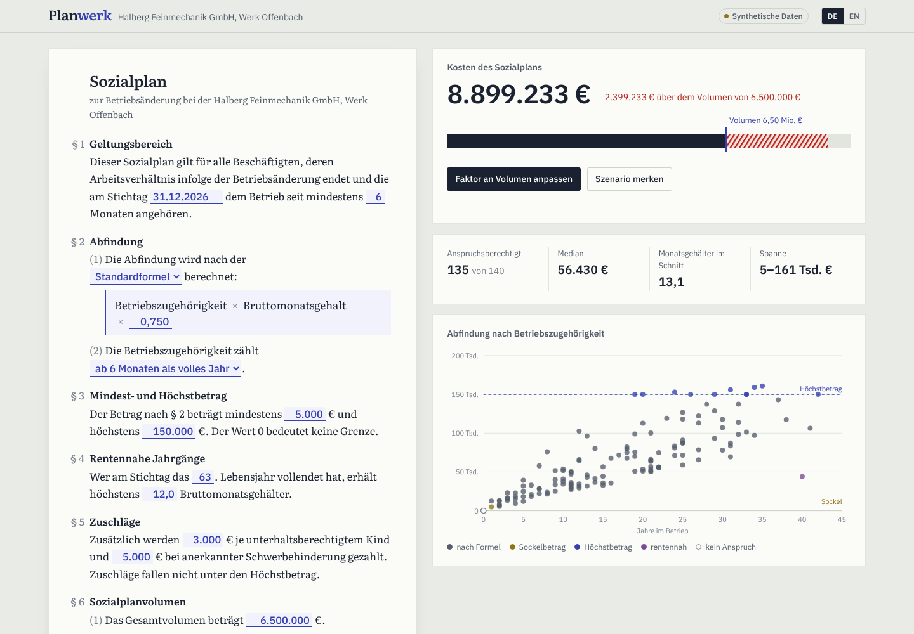
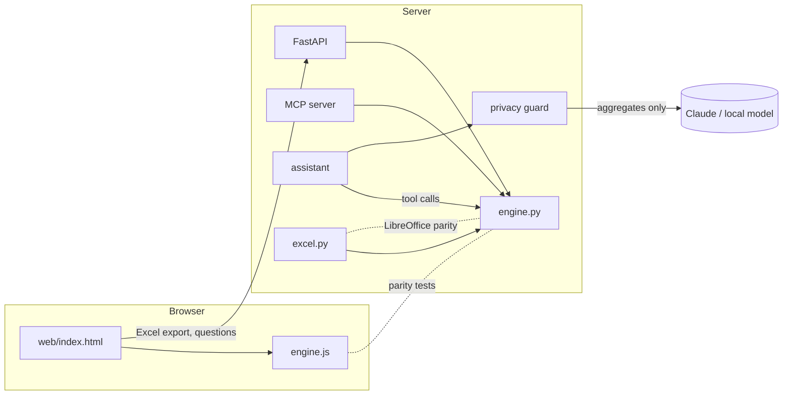

# Planwerk

**A Sozialplan calculator that lawyers can check against their own Excel.**

Employment lawyers negotiate a severance formula and a total budget at the same time, usually
in a spreadsheet that has grown for years. Planwerk turns that spreadsheet into a web app
where the Sozialplan *is* the interface: change a number in the agreement text and see what
it costs, who hits the cap, and which factor fits the agreed volume. Then hand the partner an
Excel model with live formulas that gives the same result to the cent.



**Demo:** the browser-only build runs with 140 invented employees and is published to GitHub
Pages by CI on every push to `main` (`make demo` builds it locally).

## What it does

- **The agreement as input.** §§ 1 to 7 of a Sozialplan, typeset as the document, with the
  negotiable values as fields: Stichtag, standard or divisor formula, tenure rounding,
  Sockelbetrag, Höchstbetrag, rentennahe Jahrgänge, Zuschläge, Volumen, rounding.
- **Cost against volume.** One click finds the highest factor (or lowest divisor) that stays
  within the volume; alternatively a pro-rata cut that rounds down so the volume holds.
- **Scenarios.** Save the current state and every change shows its delta against it.
- **Anlage 1.** Per-person list with the rule that bit (Sockel, Höchstbetrag, rentennah, no
  claim), Sozialauswahl points, search, filter, sort, copy to Excel.
- **Excel both ways.** Import client lists with German or English headers (in the browser,
  nothing is uploaded). Export a self-calculating model: named parameters, one column per
  calculation step, so a lawyer can audit every row.
- **Ask the plan.** "What does a 180k cap cost?" An assistant translates the question into
  engine calls and quotes the engine's numbers. It never sees a name, a birth date or a salary.
- **MCP server.** The same engine as eight tools for Claude Code, Claude Desktop or any agent.

## Why you can trust the numbers

The same rules exist three times: `planwerk/engine.py`, `web/engine.js` (the browser) and the
Excel formulas. The test suite makes them agree **exactly**:

| Test | What it proves |
|---|---|
| `test_engine.py` | each rule, pinned with a hand-calculated example |
| `test_js_parity.py` | browser engine == Python engine, every field of every row, 7 scenarios, compared with `==` |
| `test_excel_parity.py` | the exported workbook, recalculated by headless LibreOffice, == engine, 6 scenarios |
| `test_import.py`, `test_js_import.py` | client lists (German and English notation, broken rows) read the same in browser and server; no formula injection in exports |
| `test_privacy.py`, `test_assistant.py` | no personal data in logs or in anything sent to a model; cloud and on-prem model routes |
| `test_browser.py` | the web app in Chromium: typing, fitting, import, export, copy, phone layout |
| `test_api_mcp.py`, `test_cli.py`, `test_hooks.py` | interfaces, limits and error paths, agent guardrails |

131 tests, run in CI on Python 3.11, 3.12 and 3.13, after ruff and mypy.

The Excel parity test earned its place on day one: it found a row where 111,377.50 € was
111,377.4999… € in floating point and rounded differently in LibreOffice. Details in
[ORCHESTRATION.md](ORCHESTRATION.md#incident-log).

## Architecture



**Model routing** (`planwerk/routing.py`, reasoning in [docs/MODEL_ROUTING.md](docs/MODEL_ROUTING.md)):
Haiku without thinking maps unknown spreadsheet headers; Sonnet with thinking between tool
calls answers scenario questions; Opus with adaptive thinking drafts the memo for the partner.
`PLANWERK_LLM=local` sends everything to an OpenAI-compatible server on your own hardware.

## Run it

```bash
make install                                # pip install -e ".[dev]"
make serve                                  # http://127.0.0.1:8765
python -m planwerk calc                     # summary of the sample case
python -m planwerk fit --budget 6500000     # factor that fits the volume
python -m planwerk export -o out/Anlage1.xlsx
ANTHROPIC_API_KEY=... python -m planwerk ask "Was kostet ein Höchstbetrag von 180.000 €?"
ANTHROPIC_API_KEY=... python -m planwerk memo --scenario A= --scenario B=factor=0.6
make lint test                              # parity tests need node and LibreOffice
```

In Claude Code, the MCP server is registered in `.mcp.json`; try `/scenario Was passiert ohne Sockelbetrag?`.

## Working on it with agents

This repo is set up for several coding agents working in parallel:

- [CLAUDE.md](CLAUDE.md) and [AGENTS.md](AGENTS.md): the rules every agent follows.
- `.claude/hooks/`: tests run after every edit to a guarded file; no "done" while red; no client
  data, IBANs or force pushes. The hooks have their own tests.
- `.claude/agents/`: `parity-checker`, `legal-rules-reviewer`, `privacy-auditor`, `ui-builder`,
  `release-manager`.
- [ORCHESTRATION.md](ORCHESTRATION.md): lanes, contracts between them, how to spot an agent
  doing nonsense, and the incident log.

## Releases and rollback

`scripts/release.sh 1.0.0` runs the full suite, bumps versions and tags. `scripts/deploy.sh <ref>`
builds a container per commit, checks `/api/health` for the expected commit and rolls back
automatically if it does not come up. `scripts/rollback.sh` goes back one version in seconds,
because every deployed image is kept.

## Data protection

Real case data never enters the repository, the logs or a cloud prompt. Client lists are read
in the browser; the server sets a strict Content Security Policy, limits uploads, deletes temp
files after each download, and writes client text into Excel as text so a cell like
`=HYPERLINK(...)` cannot become a formula. See [SECURITY.md](SECURITY.md).
The sample company and all 140 people in it are invented (`scripts/make_sample.py`, fixed seed).

## Legal

A calculation aid, not legal advice. The background of every rule is in
[docs/RULES.md](docs/RULES.md). MIT licence.
